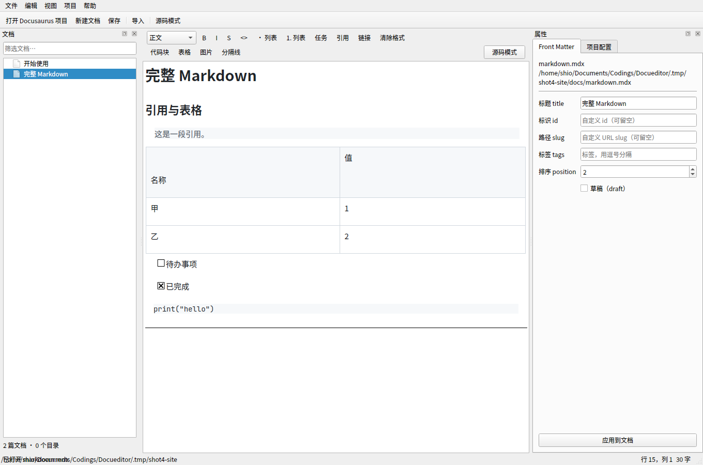

# Docueditor

> [!IMPORTANT]
> **这是一个 Vibe Coding 项目。** 本项目从第一行代码到 README 都由人类与 AI 结对“凭感觉”写就（vibe coding），
> 以可运行、可读、可改为主，不追求企业级工程规范。请把它当作一个乐于助人但不保证不出错的编辑器来使用，
> 重要文档请先备份，或使用版本控制（git）兜底。

Docueditor 是一个面向 [Docusaurus](https://docusaurus.io/) 文档站的桌面编辑器。它让你在编辑
Docusaurus 的 Markdown / MDX 文档时获得 **WYSIWYG（所见即所得）** 的舒适感：新建文件、富文本编辑、
删除文件、调整侧边栏顺序、修改项目配置，全都在一个窗口里完成。

同时，它能导入 [Novelwriter](https://novelwriter.io/) 与 [语雀](https://www.yuque.com/) 的内容，
按照原有顺序生成 Docusaurus 文档，**默认使用“增加模式”（append）而不是“替换模式”** —— 导入只会在
你的文档站里追加新页面，不会悄悄覆盖已有内容。

- 语言：Python 3.10+
- GUI：PySide6（Qt 6）
- 许可证：**GPL-3.0-only**

---

## 功能

| 能力 | 说明 |
| --- | --- |
| 打开 / 新建项目 | 识别 `docusaurus.config.{js,ts,mjs,cjs}`，自动定位 `docs/` 目录与 `sidebars.*` |
| 所见即所得编辑 | 基于 Qt 的 Markdown 文档模型，标题、粗体、斜体、删除线、列表、引用、行内代码、链接在编辑器里直接呈现 |
| 源码模式 | `Ctrl+E` 在富文本与 Markdown 源码之间切换，适合处理复杂 MDX |
| MDX 安全保护 | `import` / `export`、JSX 组件块、`:::` 指令、围栏代码块、Markdown 表格以占位符形式保留，保存时原样写回，不会被富文本转换吃掉 |
| Front Matter 面板 | 可视化编辑 `title`、`id`、`sidebar_position`、`tags`、`draft` 等常用字段 |
| 文件管理 | 新建、重命名、删除文档，自动维护唯一的文件名与侧边栏序号 |
| 拖拽排序 | 像语雀一样直接拖动文档排序，自动重写 `sidebar_position`；支持拖入目录（跨目录移动） |
| 项目配置 | 直接修改 `docusaurus.config.js` 中的 `title`、`tagline`、`url`、`baseUrl`、组织与项目名等字段（文本级安全改写，保留注释与格式） |
| 导入 Novelwriter | 解析 `.nwd` 项目（`nwProject.nwx` + `content/`），按书目顺序与层级生成文档树 |
| 导入语雀 | 支持语雀导出的 Markdown 文件夹 / ZIP / 单文件合集，转换表格、图片与语雀专有标签 |
| 导入预览 | 导入前先“预演”，列出将创建的文件、冲突处理与序号分配，确认后再落盘 |
| 追加 / 替换模式 | 默认追加：冲突文件自动加后缀，序号接在现有文档之后；替换模式需显式选择并二次确认 |
| 新建项目 | 一键生成可运行的 Docusaurus 站点骨架（config、sidebars、docs、package.json） |



## 安装

### 预编译包（推荐）

从 [Releases](https://github.com/avis-illusio/docueditor/releases) 下载对应平台的文件：

| 平台 | 文件 | 使用 |
| --- | --- | --- |
| Windows | `Docueditor-<版本>-windows-x86_64.exe` | 双击运行 |
| Linux（AppImage） | `docueditor-<版本>-x86_64.AppImage` | `chmod +x` 后运行 |
| Linux（单文件） | `docueditor-<版本>-x86_64` | `chmod +x` 后运行 |
| Debian / Ubuntu | `docueditor_<版本>_amd64.deb` | `sudo apt install ./docueditor_*.deb` |
| Fedora / RHEL | `docueditor-<版本>-1.x86_64.rpm` | `sudo dnf install ./docueditor-*.rpm` |
| Arch Linux | `docueditor-<版本>-1-x86_64.pkg.tar.zst` | `sudo pacman -U ./docueditor-*.pkg.tar.zst` |
| macOS（Apple Silicon） | `Docueditor-<版本>-macOS-arm64.dmg` | 拖入「应用程序」 |

- Linux 包依赖 `libxkbcommon`、`libEGL`、`xcb-util-cursor` 等，主流桌面环境已自带；
- macOS 包为 Apple Silicon（arm64），未签名/未公证；首次打开请右键 → 打开，或执行 `xattr -dr com.apple.quarantine /Applications/Docueditor.app`。Intel Mac 请从源码安装；
- Windows 触发 SmartScreen 时选择「更多信息 → 仍要运行」。

### 从源码安装

需要 Python 3.10 或更高版本。

```bash
git clone https://github.com/avis-illusio/docueditor.git
cd docueditor
python -m venv .venv
source .venv/bin/activate        # Windows: .venv\Scripts\activate
pip install -e .
```

只装依赖不安装项目本身：

```bash
pip install PySide6
```

## 运行

```bash
docueditor                       # 启动后从菜单打开或新建 Docusaurus 项目
docueditor /path/to/docusaurus-site
```

也可以：

```bash
python -m docueditor /path/to/docusaurus-site
```

## 基本用法

1. **打开项目**：`文件 → 打开 Docusaurus 项目`，选择包含 `docusaurus.config.js` 的目录。
2. **编辑文档**：左侧文件树选择文档，中间区域直接编辑。工具栏提供标题、粗体、斜体、列表、引用、代码与链接。
3. **保存**：`Ctrl+S`。Front Matter 与正文一起写回 `.md` / `.mdx`。
4. **调整顺序**：直接拖动文档到目标位置（同目录排序或拖进目录），`sidebar_position` 会自动重排；也可右键 `上移 / 下移` 或修改右侧面板的数字。
5. **导入**：`文件 → 导入…`，选择 Novelwriter 或语雀，先看预览，再点“执行导入”。

## 导入说明

### Novelwriter

支持两种输入：

- **`.nwd` 项目目录**：读取 `nwProject.nwx` 中的 `content` 树，按 `order` 排序，读取 `content/*.txt|*.md` 正文。
- **普通文件夹**：按文件名自然排序，每个文本文件作为一篇文档，首行 `#` 标题作为文档标题。

转换规则：

- novelwriter 的书目层级（Chapter / Scene）映射为 Docusaurus 的子目录 + 文档；
- 正文中的 `%` 注释行、`@pov`、`@location` 等标签行会被清理；
- `#` / `##` 标题保留在正文中，文档自身的 `title` 取自 novelwriter 的项目标题。

### 语雀

支持三种输入：

- 语雀导出的 **Markdown 文件夹**（保留目录层级）；
- 语雀导出的 **ZIP**；
- 语雀导出的 **单文件 Markdown 合集**（按一级标题切分为多篇）。

转换规则：

- 语雀的 HTML `<table>` 转为 Markdown 表格；
- `` 转为 Markdown 图片，`<br>` 转为换行；
- 去除 `<card>`、`<p style=...>` 等语雀专有标签；
- 文件名前的数字序号（如 `01-xxx.md`）用于确定顺序，并从最终文件名中移除；
- 文档顺序写入 `sidebar_position`。

### 追加模式（默认）

- 目标目录中已存在的同名文件 **不会被覆盖**，而是生成 `name-2.md`、`name-3.md`；
- 新文档的 `sidebar_position` 从现有最大值往后排；
- 导入完成后弹出报告：创建了哪些文件、跳过了哪些、有哪些警告；
- 替换模式必须在导入对话框中显式切换，并勾选确认框，执行时会先备份原文件为 `.bak`。

## 项目结构

```
docueditor/
├── src/docueditor/
│   ├── app.py                 # 应用入口
│   ├── main_window.py         # 主窗口
│   ├── frontmatter.py         # YAML front matter 解析与序列化
│   ├── project.py             # Docusaurus 项目模型（文档树、序号、增删改）
│   ├── config_editor.py       # docusaurus.config.js 文本级安全改写
│   ├── mdx_guard.py           # MDX / JSX / 指令块占位符保护
│   ├── importers/
│   │   ├── base.py            # 导入计划、冲突处理、落盘
│   │   ├── novelwriter.py     # Novelwriter 导入
│   │   └── yuque.py           # 语雀导入
│   └── widgets/
│       ├── editor.py          # WYSIWYG 编辑器与工具栏
│       ├── file_tree.py       # 文档树
│       ├── frontmatter_panel.py
│       ├── config_panel.py
│       └── import_dialog.py
└── tests/                     # pytest：逻辑层 + 离屏 GUI 冒烟测试
```

## 开发

```bash
python -m venv .venv && source .venv/bin/activate
pip install -e ".[dev]"
pytest -q
```

GUI 冒烟测试在无显示环境下运行：

```bash
QT_QPA_PLATFORM=offscreen pytest -q
```

## 打包

Linux 本地一键构建（需要 PyInstaller、curl；脚本会自动下载 appimagetool 与 nfpm）：

```bash
pip install pyinstaller
bash packaging/build_linux.sh
```

产物：

```
dist/docueditor-<版本>-x86_64              # 单文件 ELF
dist/docueditor-<版本>-x86_64.AppImage
dist/docueditor_<版本>_amd64.deb
dist/docueditor-<版本>-1.x86_64.rpm
dist/docueditor-<版本>-1-x86_64.pkg.tar.zst
```

跨平台构建由 GitHub Actions 完成（`.github/workflows/build-packages.yml`）：
推送 `v*` 标签或手动触发时，自动构建 Windows `.exe`、Linux 可执行文件/AppImage/deb/rpm/pkg.tar.zst、
macOS arm64 `.dmg`，并附加到对应的 GitHub Release。

打包配置位于 [`packaging/`](packaging/)：PyInstaller spec、desktop 文件、nfpm 配置与图标。

## 已知限制

- 富文本编辑器基于 Qt 的 Markdown 支持；代码块与 Markdown 表格在富文本视图中显示为占位符（保存时原样写回），编辑它们请切换到源码模式；
- 复杂的 MDX 表达式（如嵌套 JSX 内的 Markdown）建议用源码模式编辑；
- 项目配置改写是“文本级”的：它能处理常见的 `key: 'value'` 写法并保留注释，但无法理解任意 JS 表达式；
- 不内置 Docusaurus 预览服务器，可在项目目录自行运行 `npm run start`。

## 路线图

- [x] 内置 Markdown 源码模式切换
- [x] 代码块 / 表格 / JSX 往返保护
- [ ] 图片粘贴自动保存到 `static/img/` 并改写链接
- [ ] 文档内链接与锚点检查
- [ ] 导入 Notion / Obsidian
- [x] 多平台安装包（Windows / Linux / macOS）
- [ ] 多标签页编辑

## 许可证

本项目以 **GPL-3.0-only** 发布，详见 [LICENSE](LICENSE)。

```
Docueditor — a WYSIWYG editor for Docusaurus documentation.
Copyright (C) 2025 avis-illusio

This program is free software: you can redistribute it and/or modify
it under the terms of the GNU General Public License as published by
the Free Software Foundation, version 3 of the License only.
```

本项目使用 PySide6（Qt for Python），遵循其 LGPL/GPL 授权条款。
